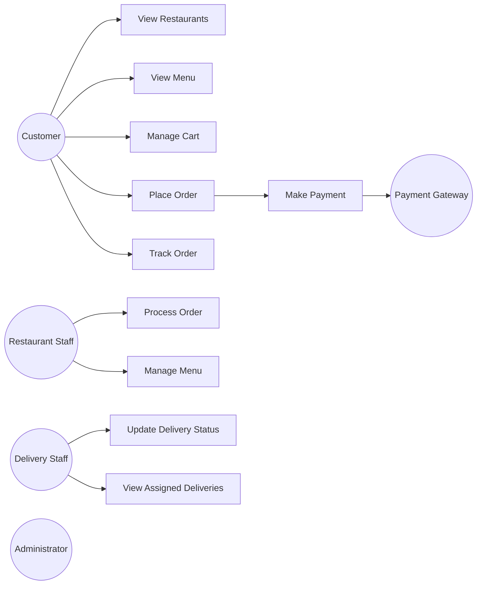
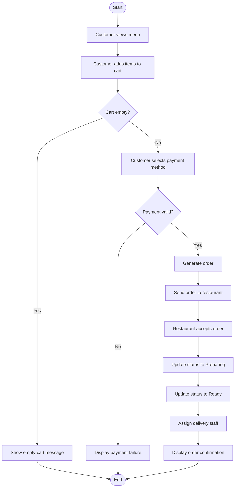
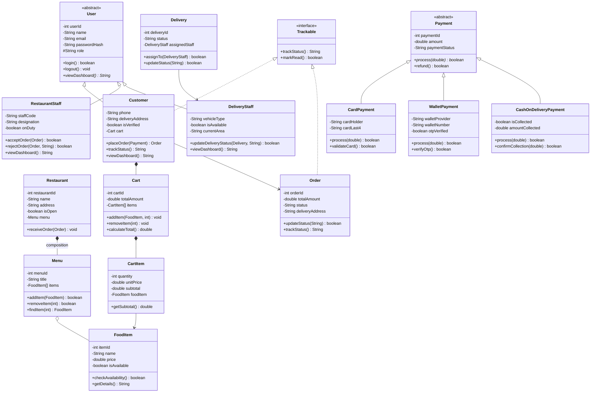

# Food Ordering System

**Software Design & Analysis — Assignment 4**

| Field | Details |
|---|---|
| Project | Food Ordering System |
| Student | Mehr Ali |
| Registration Number | 24P-0500 |
| Program | BS (CS), 9A |
| Semester | Fall 2026 |
| Course | Software Design & Analysis |
| Repository | [Astreonix/Software-design-and-analysis](https://github.com/Astreonix/Software-design-and-analysis) |

---

## Project Overview

This repository contains a Java console implementation of the Food Ordering System designed in Software Design & Analysis Assignments 1–3.

The application demonstrates the complete flow from browsing a restaurant and adding food to a cart to making a payment, placing an order, processing it, assigning delivery, and tracking its status.

The implementation follows Assignment 3's class design and covers:

- Java classes and constructors
- Composition and arrays
- Hierarchical inheritance
- Abstract classes and interfaces
- Method overloading and overriding
- Static and dynamic binding
- Runtime polymorphism
- String handling and console input
- Arithmetic, relational and logical operators
- `if`, `else-if`, `switch` and `while` control structures

---

## Application Features

### Customer use cases
- View available restaurants and menus
- View food-item availability and prices
- Add food items and quantities to the cart
- Calculate the total amount automatically
- Place an order using card, wallet or cash-on-delivery
- Track order status
- View the customer dashboard polymorphically

### Staff use cases
- Accept or reject orders
- Update order status from `Accepted` to `Ready`
- Assign an available delivery staff member
- Update delivery status
- View staff-specific dashboard information

### Technical features
- Parent `User` reference stores different child objects
- Payment hierarchy demonstrates overridden behavior
- Restaurant composition contains a `Menu`
- Cart stores `CartItem` objects in an array
- Array-based menu and restaurant management
- Console menu for repeatable user interaction
- Constructor overloading in `User`, `Customer`, `FoodItem`, `Cart` and other classes

---

## Console Menu

```text
===== Food Ordering System =====
1. View restaurants and menus
2. Add item to cart
3. Place order and make payment
4. Track order
5. Demonstrate runtime polymorphism
0. Exit
```

### Demonstration flow

1. Select `1` to view restaurants and menus.
2. Select `2` to add a food item to the cart.
3. Select `3` to choose a payment method and place the order.
4. Select `4` to track the order.
5. Select `5` to demonstrate dynamic polymorphism using `User` references.

---

## Use-Case Diagram



---

## Place-Order Activity Diagram



---

## Main UML Class Diagram



---

## Polymorphism

The `User` hierarchy demonstrates runtime polymorphism:

```java
User[] users = new User[3];
users[0] = customer;
users[1] = staff;
users[2] = deliveryStaff;

for (int i = 0; i < users.length; i++) {
    System.out.println(users[i].viewDashboard());
}
```

Each child class overrides `viewDashboard()` to return a role-specific dashboard.

The `Payment` hierarchy also demonstrates polymorphism:

- `CardPayment.process(...)` validates card information.
- `WalletPayment.process(...)` verifies wallet details.
- `CashOnDeliveryPayment.process(...)` records a pending payment.

Constructor overloading and method overloading are included where multiple valid object or calculation signatures are useful.

---

## Repository Structure

```text
Software-design-and-analysis/
├── .classpath
├── .project
├── README.md
├── src/
│   ├── main/
│   │   └── Main.java
│   └── model/
│       ├── User.java
│       ├── Customer.java
│       ├── RestaurantStaff.java
│       ├── DeliveryStaff.java
│       ├── Restaurant.java
│       ├── Menu.java
│       ├── FoodItem.java
│       ├── Cart.java
│       ├── CartItem.java
│       ├── Order.java
│       ├── Payment.java
│       ├── CardPayment.java
│       ├── WalletPayment.java
│       ├── CashOnDeliveryPayment.java
│       ├── Delivery.java
│       ├── Notification.java
│       ├── OrderController.java
│       └── Trackable.java
└── SDA_Assignment_4_Report.pdf
```

---

## Class Categories

| Package | Class | Type | Responsibility |
|---|---|---|---|
| `model` | `User` | Abstract class | Shared login and user information |
| `model` | `Customer` | Concrete / Child | Cart, order and tracking operations |
| `model` | `RestaurantStaff` | Concrete / Child | Process orders and manage menu |
| `model` | `DeliveryStaff` | Concrete / Child | Delivery assignment and status |
| `model` | `Restaurant` | Concrete | Restaurant details and menu composition |
| `model` | `Menu` | Concrete | Stores food items |
| `model` | `FoodItem` | Concrete | Food data and availability |
| `model` | `Cart` | Concrete | Stores selected cart items |
| `model` | `CartItem` | Concrete | Item quantity and subtotal |
| `model` | `Order` | Concrete | Order status and details |
| `model` | `Payment` | Abstract class | Shared payment behavior |
| `model` | `CardPayment` | Concrete / Child | Card payment processing |
| `model` | `WalletPayment` | Concrete / Child | Wallet payment processing |
| `model` | `CashOnDeliveryPayment` | Concrete / Child | Cash collection processing |
| `model` | `Delivery` | Concrete | Delivery status and assignment |
| `model` | `Notification` | Concrete | Order-status notification |
| `model` | `OrderController` | Concrete | Coordinates order operations |
| `model` | `Trackable` | Interface | Tracking contract |
| `main` | `Main` | Concrete | Console entry point and menu |

---

## Eclipse Setup

1. Install the Eclipse IDE for Java Developers.
2. Install JDK 17 or a compatible JDK.
3. Open Eclipse.
4. Select **File → Import → General → Existing Projects into Workspace**.
5. Select the project folder containing `.project`.
6. Verify that `src` is a source folder.
7. Open `src/main/Main.java`.
8. Run it as **Java Application**.

---

## Running from the Terminal

### Windows PowerShell

```powershell
Set-Location "C:\Users\mehrali\Desktop\SDA_ASSIGNMENT-4"
$env:JAVA_HOME = "C:\Program Files\Microsoft\jdk-17.0.21.102-hotspot"
$env:Path = "$env:JAVA_HOME\bin;$env:Path"

javac -d bin (Get-ChildItem -Recurse -Filter *.java -Path src | ForEach-Object { $_.FullName })
java -cp bin main.Main
```

### Linux or macOS

```bash
javac -d bin $(find src -name "*.java")
java -cp bin main.Main
```

---

## Sample Console Output

```text
Restaurant 1: Pizza Point (Main Boulevard)
11 - Chicken Pizza - Rs. 1200.0 - Available
12 - Garlic Bread - Rs. 350.0 - Available

Cart updated. Total: Rs. 2400.0

ORDER PLACED: Order #1 | Status: Ready
Payment status: Pending
Delivery #1 - Assigned - Usman

Runtime polymorphism using User references:
Customer: Customer Dashboard: browse restaurants, manage cart and track orders
RestaurantStaff: Restaurant Staff Dashboard: incoming orders and menu
DeliveryStaff: Delivery Dashboard: assigned deliveries and status updates
```

---

## Design Principles Applied

- **Inheritance:** Shared user and payment behavior is placed in parent classes.
- **Composition:** `Restaurant` contains a `Menu`.
- **Encapsulation:** Instance variables are private and accessed through public methods.
- **Polymorphism:** Parent references execute child-specific implementations.
- **Abstraction:** `User` and `Payment` define abstract behavior.
- **Interface segregation:** `Trackable` provides a small, focused tracking contract.
- **Array-based storage:** Multiple restaurants, menus, carts and orders are represented with arrays.

---

## Assignment Requirements Coverage

| Assignment 4 Requirement | Implementation |
|---|---|
| At least 8 classes | More than 18 model and main classes |
| Private instance variables | All model classes use private/protected variables |
| Public getters/setters | Provided for model state |
| Constructors | Constructors and constructor overloading included |
| Composition | `Restaurant` contains `Menu`; `Cart` contains `CartItem` |
| Array storage | Restaurants, menus, carts and orders use arrays |
| Array passed to a method | `Cart.calculateTotal(CartItem[])` |
| Inheritance hierarchy | `User` and `Payment` hierarchies |
| `super` usage | `Customer`, `RestaurantStaff` and `DeliveryStaff` constructors call `super(...)` |
| Abstract class | `User` and `Payment` |
| Interface | `Trackable` |
| Runtime polymorphism | `User[]` holds and executes child methods |
| Method overriding | `viewDashboard()` and `process(double)` |
| Method overloading | Constructor and method overload examples |
| Console menu | `Main` uses `while`, `if`, `else-if` and `switch` |
| Arithmetic/relational/logical operators | Cart totals and validation conditions |
| String concatenation | Readable console output |
| Type casting | `double` order total cast to `int` for console rounding |

---

## Author

**Mehr Ali**  
Registration Number: **24P-0500**  
GitHub: [Astreonix](https://github.com/Astreonix)
